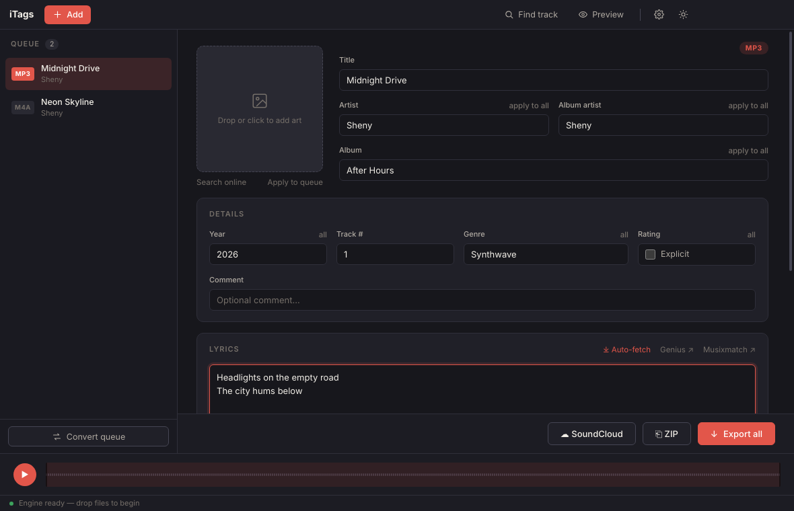

<div align="center">

# iTags

**A fast, private audio tag editor for your desktop.**
Fix titles, artwork, lyrics and filenames on a whole folder of music in a few clicks.
No account, no upload, no server.




</div>

---

## Why iTags?

Most tag editors are either heavy, dated, or want you to sign in. iTags is one small window that does the job:
drop your files in, search for the right metadata, tweak anything, export. Everything is processed on your own computer
with a bundled copy of ffmpeg, so your music never leaves your machine.

## Features

| | |
|---|---|
| **Full tag editing** | Title, artist, album artist, album, year, track number, genre, comment, lyrics and explicit flag |
| **Cover art** | Drop an image, or search Apple Music and Last.fm for high-resolution artwork |
| **Find track** | One-click metadata lookup from Apple Music (and Last.fm with a free API key) |
| **Lyrics** | Auto-fetch from LRCLIB, or jump to Genius and Musixmatch with the search pre-filled |
| **Batch work** | Edit one track, then apply an artist, album, year, genre or cover to the entire queue |
| **Format conversion** | Turn FLAC and WAV into M4A or MP3 so they accept tags, per file or for the whole queue |
| **Trim** | Drag the highlighted region on the waveform to crop a track before exporting |
| **Filename templates** | Build names from `{track}`, `{title}`, `{artist}`, `{album}`, `{year}`, `{genre}` with presets and a live preview |
| **Export your way** | Save files one by one, or bundle everything into a single ZIP |
| **iTunes Match bypass** | Optionally re-encode to ALAC so Apple's matching leaves your files alone |
| **SoundCloud upload** | Send the active track straight to your account (needs your own token) |
| **Light and dark** | Follows your system theme, or flip it with one click |

## Supported formats

| Format | Read tags | Write tags | Notes |
|---|:---:|:---:|---|
| MP3 | ✅ | ✅ | ID3v2 including cover art and lyrics |
| M4A / AAC | ✅ | ✅ | Includes the explicit rating tag |
| FLAC | ✅ | via conversion | Converted to M4A or MP3 when you want tags |
| WAV | ➖ | via conversion | WAV files rarely carry tags, so fill them in and convert to M4A or MP3 |

## Download

Grab the installer for your system from the **[Releases](../../releases)** page:

| System | File |
|---|---|
| Windows | `iTags Setup x.y.z.exe` (installer) or the `.zip` (portable) |
| macOS | `iTags-x.y.z.dmg` |
| Linux | `iTags-x.y.z.AppImage` |

<details>
<summary><b>First launch: "unknown developer" warning</b></summary>

The builds are not code-signed (signing certificates cost money), so your OS asks for confirmation once:

- **Windows:** "Windows protected your PC" → **More info** → **Run anyway**
- **macOS:** right-click the app → **Open** → **Open**. If macOS says the app is damaged, run
  `xattr -cr /Applications/iTags.app` once in Terminal
- **Linux:** `chmod +x iTags-*.AppImage`, then double-click it

</details>

## Keyboard shortcuts

Use `Cmd` instead of `Ctrl` on macOS.

| Shortcut | Action |
|---|---|
| `Ctrl` + `O` | Add audio files |
| `Ctrl` + `S` | Export all |
| `Ctrl` + `Shift` + `S` | Export as ZIP |
| `Ctrl` + `F` | Find track online |
| `Ctrl` + `Shift` + `F` | Search cover art |
| `Ctrl` + `P` | Preview tags |
| `Ctrl` + `,` | Settings |
| `Space` | Play or pause |
| `↑` `↓` | Previous or next track in the queue |
| Right-click a queue item | Convert format or remove |

You can also drop audio files anywhere in the window.

## Setting up the optional lookups

Open **Settings** (`Ctrl` + `,`):

- **Last.fm API key:** free and instant at [last.fm/api/account/create](https://www.last.fm/api/account/create).
  Adds Last.fm results to track and cover search. Apple Music search works without any key.
- **SoundCloud token:** only needed for uploads. Create an app at [soundcloud.com/you/apps](https://soundcloud.com/you/apps)
  and paste the OAuth access token. Both values are stored locally on your computer and never sent anywhere else.

## Run from source

You need [Node.js](https://nodejs.org) 20 or newer.

```bash
git clone https://github.com/shnytstic/iTags.git
cd iTags
npm install      # also copies the browser libraries into src/vendor
npm start
```

## Build installers

```bash
npm run dist          # your current OS
npm run dist:win      # Windows (.exe + .zip)
npm run dist:mac      # macOS (.dmg + .zip), must run on a Mac
npm run dist:linux    # Linux (.AppImage)
```

Output lands in `dist/`.

### Let GitHub build for every platform

The repo includes a workflow that builds Windows, macOS and Linux installers in the cloud, so you don't need a Mac to ship a Mac app.

```bash
git tag v1.0.0
git push --tags
```

A few minutes later the installers show up on your **Releases** page. You can also run it by hand from the
**Actions** tab → *Build installers* → **Run workflow**.

## How it works

```
iTags/
├── main.js            Electron main process: window, native menu, secure app:// protocol
├── preload.js         Tiny bridge exposing the platform and menu events to the UI
├── scripts/vendor.js  Copies ffmpeg, wavesurfer and friends into src/vendor (runs on npm install)
└── src/
    ├── index.html     App layout
    ├── styles.css     Theme tokens, light and dark
    ├── app.js         Tagging, conversion, search and export logic
    └── vendor/        Generated, bundled libraries (git-ignored)
```

- The UI is served from a private `app://` origin instead of `file://`, so Web Workers and WebAssembly behave exactly like on a real website.
- Audio is decoded and converted by **ffmpeg.wasm**, tags are written with **browser-id3-writer** and a small MP4 atom patcher, and
  waveforms come from **wavesurfer.js**. Nothing is sent to a server.
- The window is sandboxed with context isolation on and Node integration off. It can't navigate away from the app, and external links open in your regular browser.

## Customising

- **Icon:** add a 1024×1024 `build/icon.png` before building.
- **Name, id, version:** edit `productName`, `build.appId` and `version` in `package.json`.
- **Look:** colors and spacing are CSS variables at the top of `src/styles.css`.

## Known limitations

- SoundCloud's API may reject uploads sent straight from the app because of its CORS rules. A small proxy would fix this.
- FLAC and WAV files can only receive tags after conversion to M4A or MP3.
- Online lookups (Apple Music, Last.fm, LRCLIB) need an internet connection. Everything else works offline.

## License

[MIT](LICENSE) © 2026 Sheny
